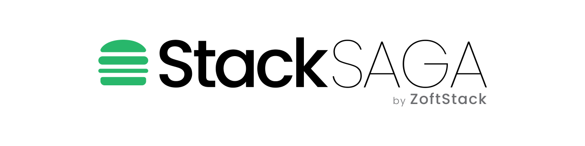

<picture>
  <source media="(prefers-color-scheme: dark)"  srcset="https://raw.githubusercontent.com/stacksaga/.github/main/profile/assets/readme-banner-dark.png">
  <source media="(prefers-color-scheme: light)" srcset="https://raw.githubusercontent.com/stacksaga/.github/main/profile/assets/readme-banner-light.png">
  
</picture>

 

---

## The Next Evolution of Saga Orchestration

**StackSaga** is the **domain-centric, natively reactive** saga orchestration ecosystem for Spring Boot.

Build resilient, high-throughput distributed microservices with **zero dedicated orchestrator servers**, **zero Transactional Outbox**, and automated reverse compensation — in a developer-friendly, compile-time type-safe environment.

> _"One framework. From Modular Monolith to full microservices — with zero saga rewrites."_

→ **[Read the full introduction](https://docs.stacksaga.org/stacksaga/latest/introduction-to-stacksaga.html)**

---

## Why StackSaga?

| | StackSaga | Temporal / Camunda | Kafka Choreography |
|---|---|---|---|
| **Dedicated Servers** | ✅ **Zero** — embedded in your service | ❌ Heavy external cluster | ⚠️ Broker clusters only |
| **Execution Model** | ✅ Natively Reactive (Project Reactor) | ❌ Thread-pool long-polling | ⚠️ Consumer thread pools |
| **Mixed STP + HITL** | ✅ Native in one pipeline | ❌ Requires external orchestration | ❌ Fragile ad-hoc state machines |
| **Type Safety** | ✅ 100% compile-time verified | ⚠️ Partially typed | ❌ Untyped JSON + string topics |
| **Transactional Outbox** | ✅ **Eliminated** — atomic Event Store | ❌ Required for every trigger | ❌ Required before every publish |
| **Monolith → Microservices** | ✅ Zero-rewrite extraction | ❌ Microservices-only | ❌ Forces broker between modules |
| **Downstream Coupling** | ✅ Zero — pure REST / gRPC APIs | ❌ SDK installation required | ❌ Topic binding required |

→ **[Full architectural deep-dive](https://docs.stacksaga.org/stacksaga/latest/architecture.html)**

---

## Core Capabilities

### ⚡ Natively Reactive & Non-Blocking
Built on **Project Reactor** from the ground up. The entire Saga Execution Coordinator (SEC) is non-blocking — thousands of concurrent sagas run on minimal CPU threads with zero thread exhaustion.
→ [Reactive Executor Docs](https://docs.stacksaga.org/stacksaga/latest/implementations/stacksaga-sync/orchestrator/executor_architecture.html#reactive-command-executors)

### 🔀 Unified Saga Model (USM) — STP + HITL in One Pipeline
The first framework to execute **mixed-style sagas** in the same pipeline: **Continuous STP** (sub-millisecond automated processing) and **Pausable HITL** (days-long human approval wait-states that release 100% of worker threads).
→ [USM Whitepaper & Specification](https://docs.stacksaga.org/stacksaga/latest/implementations/stacksaga-sync/orchestrator/unified-saga-patterns.html)

### 🛡️ Spaghetti-Less, Compile-Time Type-Safe Architecture
Strongly-typed `CommandExecutor<T>` and `QueryExecutor<T>` generics with compiler-verified step transitions — no broken string references, full IDE autocomplete, refactor-safe pipelines.
→ [Executor Architecture](https://docs.stacksaga.org/stacksaga/latest/implementations/stacksaga-sync/orchestrator/executor_architecture.html)

### 🏗️ Domain-Centric — Monolith to Microservices, Zero Rewrites
Run as an in-process Modular Monolith at `<1ms` speeds today. When you extract a module into a standalone microservice, your saga pipelines, compensations, and event log stay **100% intact**.
→ [Architecture Overview](https://docs.stacksaga.org/stacksaga/latest/architecture.html)

### 🔄 1-to-Many Multi-Stage Compensations
Real enterprise rollbacks need more than a single undo. Chain `Pre-RevertExecutor` → `doRevert()` → `Post-RevertExecutor` for fraud holds, audit logs, and customer notifications — without polluting primary business logic.
→ [Compensation & Revert Patterns](https://docs.stacksaga.org/stacksaga/latest/implementations/stacksaga-sync/orchestrator/executor_architecture.html)

### 🗄️ Zero-Infrastructure Event Sourcing
Your existing **PostgreSQL, MySQL, Oracle, or Cassandra** database becomes the immutable event store. Event Store writes commit **atomically within the same ACID transaction** as your domain logic — the Transactional Outbox pattern is completely eliminated.
→ [Event Store & Database Support](https://docs.stacksaga.org/stacksaga/latest/implementations/stacksaga-sync/orchestrator/unified-saga-patterns.html)

### 🔁 Lock-Free Distributed Retries
**Murmur3 token-ring partitioning** assigns conflict-free retry ownership across cluster nodes — no locks, no single point of failure, automatic self-healing rebalancing on scale-out.
→ [Ring Coordinator Docs](https://docs.stacksaga.org/stacksaga/latest/implementations/ring-coordinator/introduction.html)

---

## The Ecosystem

<table>
<tr>
<td width="50%">

### 🔧 Unified Orchestrator Engine (SEC)
`stacksaga-spring-boot-starter`

Domain-embedded execution coordinator. Drives Continuous STP, Pausable HITL, Two-Stage messaging, and deterministic reverse compensation — all in one framework.

→ [SEC Documentation](https://docs.stacksaga.org/stacksaga/latest/introduction-to-stacksaga.html)

</td>
<td width="50%">

### 🗃️ Zero-Infrastructure Event Store
`stacksaga-database-support`

Turns your existing database (MySQL, PostgreSQL, Oracle, Cassandra, ScyllaDB) into an immutable saga event store. No extra clusters. No background pollers.

→ [Database Support Docs](https://docs.stacksaga.org/stacksaga/latest/implementations/stacksaga-sync/orchestrator/unified-saga-patterns.html)

</td>
</tr>
<tr>
<td width="50%">

### 🔁 Ring Coordinator
`stacksaga-ring-coordinator`

Cluster coordination via Murmur3 token-ring partitioning. Conflict-free, lock-free retry ownership assignment across nodes. Zero SPOF.

→ [Ring Coordinator Docs](https://docs.stacksaga.org/stacksaga/latest/implementations/ring-coordinator/introduction.html)

</td>
<td width="50%">

### 📊 Trace Window
`stacksaga-trace-window`

Real-time visualization of saga executions, step states, and failure diagnostics. Data stays inside your VPC. Manual replay for incident recovery.

→ [Trace Window Docs](https://docs.stacksaga.org/stacksaga/latest/implementations/trace-window/introduction.html)

</td>
</tr>
</table>

**Start with SEC + Event Store. Add Ring Coordinator for distributed retries. Add Trace Window for full observability.**

---

## Get Started in Minutes

**Step 1 — [Generate your project config with StackSaga Initializer](https://init.stacksaga.org)**
Select your Spring Boot version, build tool, orchestrator type, and database — get the exact BOM and dependencies to paste into your project.

**Step 2 — [Follow the Quick Start guide](https://docs.stacksaga.org/stacksaga/latest/quick-start.html)**
Add the generated dependencies to your Spring Boot service and configure your data source.

**Step 3 — [Define your first saga](https://docs.stacksaga.org/stacksaga/latest/implementations/stacksaga-sync/orchestrator/executor_architecture.html)**
Register executors, define step transitions, and start orchestrating.

---

## Resources

| Resource | Link |
|---|---|
| 📖 **Documentation** | [docs.stacksaga.org](https://docs.stacksaga.org/stacksaga/latest/introduction-to-stacksaga.html) |
| 🚀 **Project Initializer** | [init.stacksaga.org](https://init.stacksaga.org) |
| 📐 **USM Whitepaper & Specification** | [docs.stacksaga.org › unified-saga-patterns](https://docs.stacksaga.org/stacksaga/latest/implementations/stacksaga-sync/orchestrator/unified-saga-patterns.html) |
| 🏗️ **Architecture Overview** | [docs.stacksaga.org › architecture](https://docs.stacksaga.org/stacksaga/latest/architecture.html) |
| 🔭 **Trace Window Cloud** | [trace.stacksaga.org](https://trace.stacksaga.org) |
| 💬 **Discussions & FAQs** | [GitHub Discussions](https://github.com/stacksaga/stacksaga-community/discussions) |
| 🌐 **Website** | [stacksaga.org](https://stacksaga.org) |
| 🐳 **Docker Hub** | [hub.docker.com/u/stacksaga](https://hub.docker.com/u/stacksaga) |
| 💡 **Stack Overflow** | [stackoverflow.com/search?q=stacksaga](https://stackoverflow.com/search?q=stacksaga) |
| 📜 **License (SSAL 1.0)** | [stacksaga.org › license › ssal-1.0](https://stacksaga.org/legal/license/ssal-1.0) |

---

Built with ❤️ by **[Zoftstack](https://zoftstack.com)**

*StackSaga and the StackSaga logo are trademarks of Zoftstack.*

